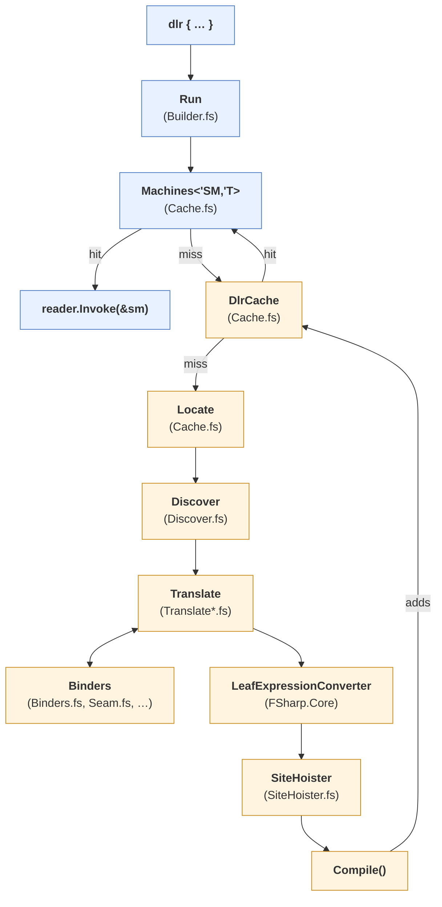
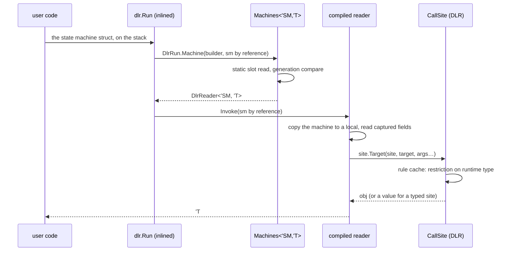
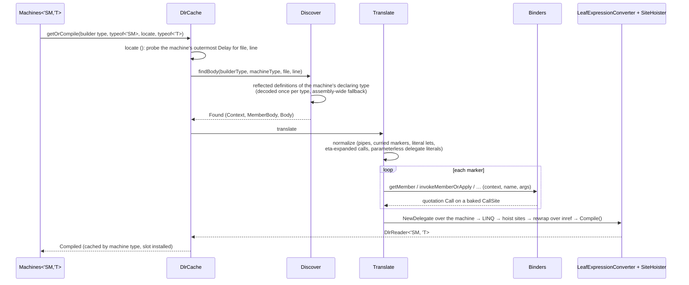

# The pipeline

From `dlr { … }` in source to the delegate a call invokes, and what one call costs. Part of
[internals](internals.md).

## From source to delegate

Blue is every call; orange is the first call at a site (and again after `DlrCache.clear()`).

- **`dlr { … }`**: F# desugars it to `dlr.Run(dlr.Delay((fun () -> …), file, line))`.
- **`Run`**: inline resumable code. The compiler builds a struct state machine `'SM` per block;
  its captured variables are the fields, and `typeof<'SM>` is the key.
- **`Machines<'SM,'T>`**: one static slot per machine type; a hit is a field read and a
  generation compare.
- **`reader.Invoke(&sm)`**: field reads, and one `CallSite` per operation.
- **`DlrCache`**: machine type → `Compiled`.
- **`Locate`**: the block's file and line, from a probe of its outermost `Delay` (below).
- **`Discover`**: the block's body, from the enclosing member's `[<ReflectedDefinition>]`, by
  file and line.
- **`Translate.translate`**: `normalize`, then Plumbing / Members / Captures, giving a quotation
  with the `CallSite`s baked in.
- **Binders** (`Binders.fs`; `Seam.fs`, `Functions.fs`, `SiteCaches.fs`): one `CallSite` per
  operation, C#'s binder wrapped by the F#-aware ones.
- **`LeafExpressionConverter`**: quotation → LINQ tree.
- **`SiteHoister`**: `CallSite` constants → locals, per lambda.
- **`Compile()`**: a `DlrReader<'SM, 'T>` (`inref<'SM> -> 'T`).

`Run` is `inline` resumable code in the `task { }` builder's shape (`__stateMachine` with a
`MoveNext` that would run the body and an `AfterCode` that is our entry): the compiler turns
each block into a **struct** whose fields are the captured variables — the machine `task`
would suspend on, used here as the block's container — and hands `AfterCode` a `byref` to it.
`MoveNext` is never called except once on a miss, as the probe below; the struct's type is the call site's identity (a JIT constant in
`DlrRun.Machine<'SM, 'T>`, keying the [`Machines<'SM,'T>` slot](caches.md)) and its fields are
the captured values. The compiled reader takes the machine by reference and reads the captured
variables off its fields ([translation](translation.md)). No closure is allocated and no
`GetType()` runs.

**Locating the block.** The caller's file and line are `Delay`'s arguments, not `Run`'s.
Compilers have handled caller-info arguments on `Delay` the same way across versions; on `Run`,
the member holding the `if __useResumableCode` branches, they have broken Debug builds more than
once, a warning on every block from one compiler generation (#126) and a build failure from
another (#235). So `Run` has no file and line to pass. On a miss, `Locate`
(`Cache.fs`) runs the block's code once with `DlrLocation`'s thread-static flag set — `MoveNext`
on a boxed copy of the machine, or the fallback's `ResumableCode` on a fresh one — and the
outermost `Delay` writes its file and line there and returns without running the body. A hit
never probes. Thread-static, not fields in `DlrData`: those would grow every machine, and with it
the boxed copy a compiled loop or `try` makes per call; and two threads may probe at once. The
probe runs no user code, so it cannot nest. Code that does not start with the builder's `Delay`
(its members called by hand) answers nothing, and `Locate` raises `DlrTranslationException`.

**Fallback.** Where the compiler does not build the machine (`__useResumableCode` is false:
some compilers' Debug builds, and the one shape below), `Run`'s `else` branch gets the
`ResumableCode` delegate. `DlrRun.Closure` reads the block's `Delay` closure out of its target
(the builder's `Delay` lambda holds it in a field named `delayed`, read by `Delayed<'T>`, a reader
compiled once per result type) and continues on the closure path: the closure's type is the key,
its fields the captured values, [`Sites<'T>`](caches.md) the cache. Same `Discover` and
`Translate`; the cost is three allocations and two `GetType()` compares. `Tests.ClosureBuilder`
(`-p:DlrClosures=true`) runs the whole suite on this path, whatever the compiler does in Debug.

**The one shape Release leaves to the fallback.** A block whose result is a function, applied
where it is created, gets no state machine even in Release, and no warning:
`(dlr { return x?Add } : int -> int -> int) 1 2`, also partially applied or through a pipe, and a
function-typed block bound with `let` and applied once (the optimizer inlines the binding into
that application). The optimizer moves the application into both branches of `Run`'s
`if __useResumableCode`, and the compiler no longer recognises the state machine. Such a block
takes the fallback with its `Delay` wrapper inlined: the delegate's target is the closure itself,
or null when the block captures nothing, and then `DlrRun.Closure` compiles from the closure's
class (`code.Method.DeclaringType`). Bound with `let` and applied twice, it gets its machine.
`Tests/Resumable.fs` pins these shapes (#217).

## One call on the hot path

The method-call row of [benchmarks.md](benchmarks.md) puts `w?Add(i, 1)` a few nanoseconds
over C# `dynamic`'s `d.Add(i, 1)`, with no allocation but the box of a value result (the same
box C# pays): what remains of the block's entry is the machine's construction, the slot read
and the invoke; the site call itself is C#'s. (The closure path roughly
doubles the entry with the closure allocation, `GetType()` and the compare. A `Func<'SM, 'T>`
taking the struct by value instead of the `inref` reader measured slower —
[translation](translation.md) has the number.)

What is left over C# is the entry path itself, which measured alone (no site) accounts for the
whole gap, and it is one delegate hop more than C# has: C# emits the site call inline in the
caller and pays one indirect call, into the rule; we pay that plus the call into the compiled
reader (a `DynamicMethod` delegate, through its shuffle thunk), and build and copy the machine
around it. A library cannot remove that hop: the compiled body would have to be emitted into
the caller's own method, which is compiler or source-generator territory (the analyzer
rewriting the block at build time, say). Everything short of that has been measured and taken;
treat the gap as the floor rather than something a faster cache or delegate shape would close.

## The first call at a site

The reflected definition is unaffected by the resumable-code machinery: the quotation is taken
before inlining, so `Discover` still sees `Run(Delay((fun () -> …), file, line))`.

Microseconds to low milliseconds, once per site: decoding the reflected definition (per type,
[cached](caches.md)), building the [binders](binders.md) and [sites](call-sites.md), `Compile()`
after the [sites are hoisted into locals](call-sites.md#sites-hoisted-into-locals). The DLR's own
first bind per site (the rule) is paid on the first invoke like any C# `dynamic` call site.

That work runs on the thread making the first call, and FSharp.Core's quotation-to-LINQ
converter takes a large stack frame per nesting level of the block's expression: a deep block on
a small thread stack (an IIS worker's 256 KB, .NET 8's 512 KB default on macOS) can overflow it,
which ends the process rather than raising an exception (#254).

## Measured

Every number is generated: [benchmarks.md](benchmarks.md), written by `Benchmarks/bench.sh docs`
(Release, net10.0, Apple Silicon), has the block against static calls, cached reflection,
FSharp.Interop.Dynamic and C# `dynamic` for each operation, and the README's short table is
inserted from the same run.

- A member read as an F# function (`let add: int -> int -> int = dlr { return w?Add }`): the
  benchmarks row times the read and one application together. Once bound, each application is
  one site call, like C# `dynamic`'s `d.Add(…)`, without re-entering the block.
- One site alternating between a CLR method and an F# function member has no row: it pays a
  rule-cache miss on every switch, several times the cost of either kind alone.
